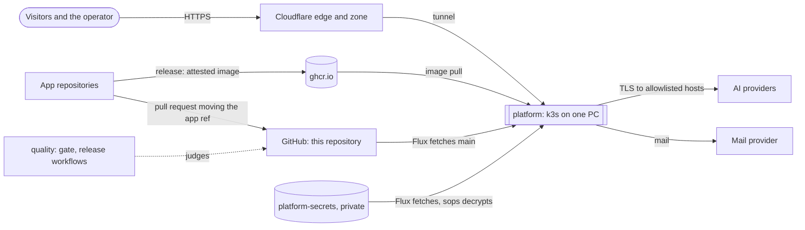
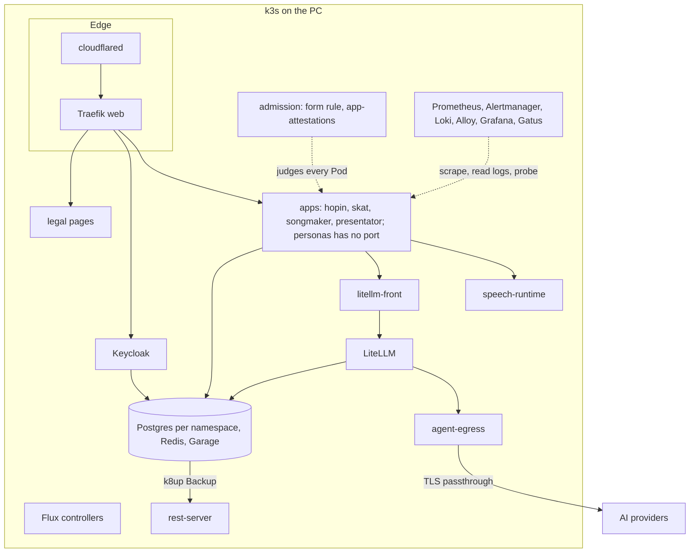
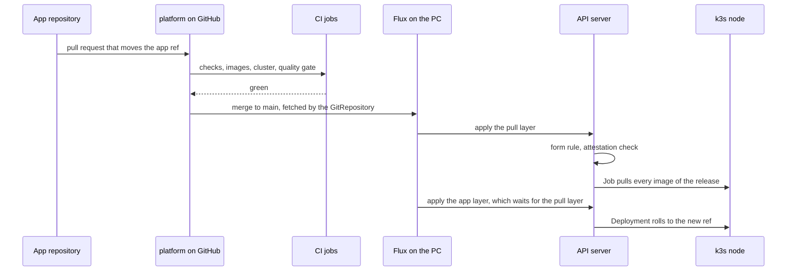

# platform architecture

Reader: an engineer or agent who changes a layer, a boundary or who may reach what. It holds the parts and their
reasons. The contracts stand in the references `AGENTS.md` lists, the procedures in `docs/runbooks/`.

## 1. Context and Scope

The platform runs the operator's apps on one PC: k3s on one node, with Flux reconciling the whole state from Git. It
holds no app code. Outside it: the apps' repositories and their release path, GitHub, Cloudflare, the AI providers and
a mail provider. hal, another of the operator's programs, runs beside it on the same PC.

Context: who and what talks to the platform. Sources: `clusters/pc/`, `infrastructure/cloudflared/config.yaml`,
`infrastructure/litellm/egress-allowed.yml`, `.github/workflows/ci.yml`.

Also here: the OpenTofu roots `src/opentofu/github` and `src/opentofu/cloudflare`, which declare the fleet's GitHub
settings and the zone's lookups, and `src/legal`, which validates the legal pages' sources.

## 2. Building Block View

The host parts (`host/`) hold k3s's config, the pod-log bounds, journald's retention, the inotify limits, the tmpfiles rule that ages out Codex's session files
and the global git hook that runs quality. Flux's three controllers (source, kustomize, notification; no Helm controller) apply one Kustomization per
layer, listed in `clusters/pc/`. Each layer is a directory of manifests under `infrastructure/` or `apps/`. A base is
a directory a layer includes and that is no layer: `infrastructure/postgres`, `infrastructure/redis`,
`infrastructure/design` and `infrastructure/pull`.

Container: the layers and who sends to whom. Sources: the Kustomizations in `clusters/pc/` and each layer's
NetworkPolicies.

- Edge: `infrastructure/cloudflared` (the tunnel's lines, one host each) and `infrastructure/traefik`, whose file
  provider holds Keycloak's routers; hopin, skat, songmaker, presentator and the legal pages route by Ingress.
- Identity: `infrastructure/keycloak`, the realm `hallucinai` and master, applied by the Job `config-cli`.
- AI: `infrastructure/litellm`, three parts: the gateway with keys and budgets in its Postgres, its front, and
  `agent-egress`, the one path to the providers. `apps/speech-runtime` runs a CPU Deployment and a GPU one behind one
  Service, and its layer `speech-runtime-bridge` holds the Job that raises the CPU Deployment before a GPU release rolls;
  `infrastructure/nvidia` offers the node's one card.
- Data: `infrastructure/storage` (local-path, class Retain), `infrastructure/postgres`, `infrastructure/redis`,
  `infrastructure/objectstore` (Garage, S3 for apps).
- Backup: `infrastructure/k8up` and `infrastructure/backup`, whose rest-server holds one repository per namespace.
- Observability: `infrastructure/prometheus` (with Alertmanager), `infrastructure/loki`, `infrastructure/alloy`,
  `infrastructure/grafana`, `infrastructure/gatus`.
- Admission: `infrastructure/admission` (form rule, the vendor list) and `infrastructure/app-attestations` (Kyverno).
- Apps: `apps/hopin`, `apps/personas`, `apps/presentator`, `apps/skat`, `apps/songmaker`, `apps/speech-runtime`; hopin, presentator,
  skat and songmaker each have a `pull` layer that puts their release's images on the node first.
- Legal pages: `infrastructure/legal`; `infrastructure/design` is the one copy of the design kit.
- `infrastructure/namespaces`: the Namespaces that receive Secrets.

## 3. Runtime View

The core flow is a release reaching the cluster. Nothing changes the cluster but a merge to main.

Flow: a new app release. Sources: `.github/workflows/ci.yml`, `infrastructure/pull/pull.yaml`, `clusters/pc/apps.yaml`.

## 4. Deployment View

One node. `scripts/bootstrap_pc.sh` installs the host parts, k3s and Flux; Flux then reads this repository's main
branch at `clusters/pc` and the private repository `platform-secrets`. The PC's own steps are the runbooks'.
GitHub Actions runs a copy: the `cluster` job applies the layers a part declares to a k3d cluster, whose
`platform-secrets` source serves dummy Secrets.

## 5. Crosscutting Concepts

### Trust

Facts of today's boundaries, each held by a manifest or a cell:

- The only way in from outside is the tunnel. Cloudflare terminates TLS; Traefik's `web` admits only pods of
  `cloudflared` and `gatus` and trusts forwarded headers from the pod network. `mise run offline` suspends the
  Kustomization `tunnel` and ends `cloudflared`, which takes every public name off at once while the apps keep running,
  and `mise run online` brings them back (`docs/runbooks/take-the-platform-offline.md`). Gatus reaches `cloudflared`'s
  metrics port, the one NetworkPolicy opening it, to show the tunnel's state.
- Namespaces enforce Pod Security `restricted`. `presentator` only warns, since its build worker's init container
  holds `NET_ADMIN` to load a packet filter that leaves the worker no connection but replies to its web.
  `nvidia` and `local-path-storage` carry no label, as both mount a hostPath.
- Postgres and Redis admit only their own namespace, and Garage admits only the web pods of presentator and songmaker
  and songmaker's backup pod, restore test and the loader of `db:load-dump`; Keycloak admits Traefik and its own namespace; backup repositories admit only a
  namespace's own user. The build worker's NetworkPolicy lets it send nothing.
- The API server admits an image only as a vendor repository at a sha256 digest or a full app ref
  (`infrastructure/admission/image-vendors.yaml`). Kyverno's `app-attestations` admits an app ref only with the
  attestation quality's release workflow signed for that repository's main branch. A Pod's create and image change
  meet both; workload objects meet the form rule.
- Secrets live in `platform-secrets`, decrypted by Flux with the age key in the Secret `sops-age`; this tree holds
  none, and the tunnel's token and credential are one Secret.
- The ServiceAccount `bridge` of `speech-runtime-bridge` reads the two speech Deployments and scales only the CPU
  one; no right reaches the GPU Deployment's scale, so no Job can start or stop the card's user.
- The release App's private key lives only in the environment `release-bump` of platform, which only a job on main
  reads (`docs/github-settings.md`, GH-8).
- LiteLLM's provider keys reach no host but those `infrastructure/litellm/egress-allowed.yml` lists: only `agent-egress`
  dials out, and it dials only those upstreams.
- Keycloak's admin console, Grafana and Gatus are reached through a port-forward from the PC; the tunnel routes
  none of them. Only the realm `hallucinai`, its localization and its static resources are routed.
- No access token carries a person's name or e-mail address; the ID token and userinfo do.
- A declared test person can sign in to hopin, skat, presentator and songmaker only during a run of `mise run live:check`: at rest it is disabled with no
  credential, and the boundary that keeps its password from a non-cooperative agent is the operator's account on the PC;
  an app's live journeys get only that app's session cookies of the run, in a file deleted on exit and valid until the run
  signs out; the boundary that keeps a copy from a non-cooperative journey is the operator's account, as for the password.
- Each Postgres declares the role `reader` at every start (`infrastructure/postgres/scripts/reader_role.sh`), with no
  password and no right but `pg_read_all_data`'s, and `mise run db:read <namespace>` runs an agent's SQL as it through
  `kubectl exec`, in a read-only session whose timeouts it sets, after a check that the session is that role. It is a
  tripwire, an aid for a cooperative agent that stops a mistaken write: its contract is the refusals
  `tests/postgres/reader_refuses_the_listed_writes_and_returns_at_start.sh` lists, and the boundary against a
  non-cooperative agent is the operator's account on the PC, whose cluster-admin kubeconfig reaches the superuser
  through `kubectl exec`.
- Flux reads two sources: this repository's default branch and `platform-secrets`.

### Proof strategy

CI is the gate (`.github/workflows/ci.yml`). `checks` runs the tree's own tests and the scripts' unit cells; `scope`
chooses the parts of `cluster` from the changed paths (`tests/flux/parts.yaml`); `cluster` applies each part's layers
to k3d and runs its cells; `bootstrap` runs the host step on a bare Ubuntu image; `opentofu` tests both roots;
`images` renders the tree as Flux does and judges every image and Flux source; `keycloak-hold` and `app-garage` prove
the two entries an app's own CI calls; `release-bump-scope` judges every `release/*` pull request of this repository with
the base's `scripts/release_bump_scope.sh`, run on the merge commit read as data, so that a bump changes only one app's
release Component, legal copies and their entries, and passes every other run; `quality` is the shared gate. A cell is
a script under `tests/<area>/` named for what it proves. `release-bump.yml` computes each app's bump on its schedule or
on dispatch, without a write credential, and publishes nothing yet.

### Persistence and backup

A namespace with a database includes `infrastructure/postgres`: its own Postgres on the Retain class, its claim
carrying the prune annotation. k8up backs each up weekly into the namespace's repository on the rest-server, with a
monthly check; `backup:now` takes one backup and proves it with the restore test.

## 6. Constraints and reasons

- Charts reach Git rendered (`charts:render`, never edited by hand); `cluster` fails on a difference, so what Flux
  applies is what CI judged. Helm runs only there. A chart or image bump changes version, digest and the pinned
  images together; Renovate sees an image only where `values.yaml` states repository, tag and digest in that order.
- Apply order: `namespaces`, `platform-secrets`, `tunnel`; `admission` after `namespaces`, every workload layer after
  `admission`, a layer with an app ref after `app-attestations`. `storage`, `k8up` and `objectstore` come before the
  layers that use them. Nothing waits for `nvidia`.
- The root Kustomization health-checks only its controllers and source, so a failing layer reports itself and the
  root keeps applying the rest.
- A Namespace with Secrets carries `prune: disabled`: neither a prune nor a revert may delete it with its Secrets. One
  removed from Git leaves only after its Secrets left `platform-secrets`. Prometheus' Namespace stands there too.
  A Namespace moves between Kustomizations in one commit when the layer that drops it depends on
  `infrastructure/namespaces`, directly or through its `dependsOn` chain: `namespaces` applies first and sets the prune
  annotation and its own owner labels on the live object, so the dropping layer's garbage collection skips it.
- k8up skips Snapshot objects, which would record the repository URL with its password, and backs up only a claim with
  its annotation. A namespace that joins the backup joins its component, its `rest-users` entry and the rest-server's
  NetworkPolicy, and the rest-server needs `kubectl -n backup rollout restart deployment/rest-server`, since it builds
  its users at its start.
- Postgres passwords use `A-Z a-z 0-9 - _`, as LiteLLM reads one unescaped in a URL.
- cloudflared reads its lines once at start, so the Deployment carries the annotation checksum/config.
- Alloy is a plain manifest, since the chart's ClusterRole grants `secrets`, `configmaps` and `nodes`. It drops a line
  older than one hour, since Loki deletes a chunk by its newest line.
- `src/legal` has its own `pyproject.toml` and no root one, which would make `tests/` a judged tree.
- A k8up bump replaces the sha256 of its chart and CRD lines in `mise.toml` by hand.

## 7. Not chosen

- A Helm controller: its output would differ from what CI judges. Reopens only with a way to render it in CI.
- Alloy from its chart: no value narrows the ClusterRole. Reopens when one does.
- Time-slicing the card: one unit, one holder, chosen by `gpu:use`. Reopens when two GPU users must run together.
- Redis that persists: what must last lives in the app's Postgres. Reopens when an app needs a queue that survives.

## 8. Risks and Technical Debt

- k3d proves neither the tunnel's edge, the token mount, `/ready`, the card nor the runtime handler
  (`docs/runbooks/gpu-runtime-handler-missing.md`), and no mail delivery; only the PC's synthetic alert does. A Pod
  that names the `nvidia` class without the limit might reach the card.
- `images` does not render `platform-secrets`; a `substituteFrom` Secret's variables render empty or at their defaults.
- Scaling Kyverno to 0 opens the attestation check, since Kyverno deletes its webhooks then; only cluster-admin or
  Flux can. While ghcr.io or Sigstore's mirror is unreachable, a new or image-changed app Pod is refused until
  `admission:pause`; a forgotten pause raises no alert.
- Alertmanager's failed sends show only in its counters; a rotated password is read after the next restart.
- A volume outlives its claim, but k3s's uninstall script deletes the volume objects: restic is the only restore path, and
  its repository is a claim on the same disk.
- OpenTofu provider 6.13.0 cannot carry `require_extra_approval_for_unattributed_changes` and returns no default for a
  `true_false` property; a test holds the count at 0.
- Renovate misses `MISE_VERSION`, `mise.lock`'s tools and the digests in `ci.yml`'s `env`, and opens no pull request
  of its own.
